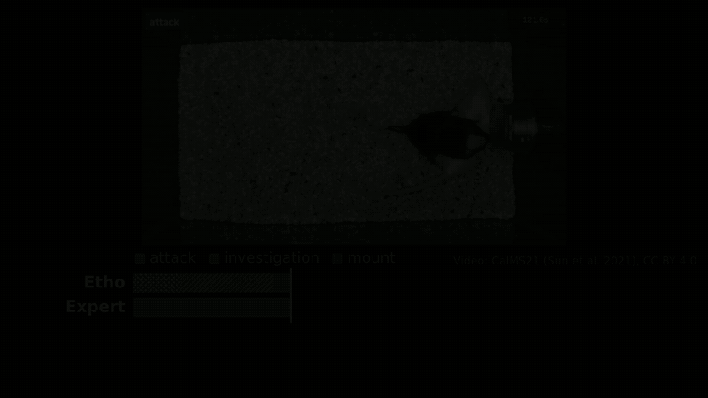

# Etho


<sub>Video: CalMS21 (Sun et al. 2021), CC BY 4.0.</sub>

**Animal behavior scored from plain-English definitions, with no training,¹ on Meta's SAM 3.1, Muse Spark and
Muse Spark Open.** Scored once on the official test set of a published, expert-labeled benchmark (CalMS21), against
the published supervised baselines:

| CalMS21 Task 1 test set, 19 videos, frame-level F1 | Macro | Attack | Investigation | Mount |
|---|---|---|---|---|
| **Etho, no training¹** | **0.58** (95% CI 0.49–0.62) | 0.449 | 0.635 | 0.656 |
| Supervised, trained on the 70 labeled training videos from pose keypoints (Sun et al. 2021, Tables 1, 2) | 0.79–0.86 | | | |

- **Speed:** scores a video unattended in about its own length (0.88× real time on test; worst 1.54×); manual
  scoring takes 3–4× (Segalin et al. 2021). A runtime comparison, not demonstrated labor savings: human review and
  correction time were not measured.
- **Cost:** model API cost for this fixed benchmark pipeline was $11.25 per hour of video, excluding the planner,
  one-time detector synthesis, hosting, and human review.
- **Every label is auditable:** the rule that fired, the frame-strip verdict, and which step decided.

**[Try it live](https://etho-vm.tail9158ab.ts.net)**: the precomputed showcase is open to everyone; live uploads
need the access code from the submission form.

Upload lab video, write behavior definitions in plain English, and get a scored ethogram, metrics, and an auditable
methods report. Built for the Meta Global AI Developer Hackathon (Push the Frontier). Numbers: `eval/results/test1_report.md`
§11.1 (supervised references: Sun et al. 2021, arXiv:2104.02710, Tables 1 and 2: .793, .829, .864).

¹ Pipeline settings were tuned on 13 labeled development videos and scored once on the 19 official test
videos. Test-label summaries (behavior and bout counts) informed dev-set selection, the 10 fps sampling
rate, and targets; no test predictions were used to choose settings. Full results and disclosures: `eval/results/test1_report.md`.

## Setup

```bash
uv sync                      # Python 3.11+, installs deps into .venv
make check                   # lint + tests (no network needed)
```

Model-written detector code runs in a sandbox: an AST check, rlimits, and (when available) bubblewrap
isolation with no network and a minimal read-only filesystem. Install it with `sudo apt install bubblewrap`.
`ETHO_SANDBOX=bwrap` requires it (jobs fail if it is unusable), `ETHO_SANDBOX=rlimit` forces the weaker
rlimit-only mode, and unset picks bwrap when it works and logs a warning when it does not. The mode in effect
is shown in `/api/config` and in each project's audit view. Clone outside `/tmp`: the sandbox gives detector code a
private `/tmp`, so a `.venv` under `/tmp` is invisible to it and bubblewrap is reported unusable.

API keys go in `~/.config/etho/secrets.env` (outside the repo):

```
META_MODEL_API_KEY=...
BASETEN_API_KEY=...
FIREWORKS_API_KEY=...
# TOGETHER_API_KEY=...   (optional)
```

All model calls go through `etho/gateway/`, which enforces per-provider spending caps, caches every
response on disk, and logs each call to `ops/spend.jsonl`. `bin/spend` prints totals.

## Web app

```bash
bin/app                         # http://127.0.0.1:8000 (localhost only; --host / --port to change)
uv run python scripts/make_showcase.py --help   # package an existing pipeline run as a zero-spend showcase
uv run python scripts/make_sample_clip.py       # cut the 60 s CalMS21 dev-split sample clip into data/showcase/_sample/
uv run python scripts/package_job_showcase.py --help   # package a finished app job as a showcase (real timings)
uv run python -m tests.mock_server              # the real app on synthetic stages and a fake gateway (no spend)
```

Upload (mp4/mov/avi, <= 200 MB, <= 5 min, checked with a hardened ffprobe that counts real frames, before anything is
spent), edit the behavior definitions, and watch the job stream stage by stage. Results show the overlay video synced
with the ethogram, per-stage time and cost, the end-to-end speed as a multiple of the video's duration, and the audit
trail. Mark wrong or missed bouts and "Revise rules" to see what changed. Trying the correction loop on a showcase
makes you a private copy first; the showcase itself never changes.

The results page opens with a perception-plan card (the phrases Muse Spark proposed, SAM 3.1's image-check counts and video-probe
result for each, the chosen phrase, identity cue and method, planner cost; precomputed showcases that skipped the planner say so).
While a job runs the page shows five phases (plan, tracking, rules, frame-strip check, report), a status line per phase and a
large elapsed-time clock counted from the job's own start. A refused or failed job shows a plain sentence and a link to the
showcases, never an error text. The ethogram is laid out for a shared screen at 150% zoom (behaviors are told apart by label and
fill pattern, not colour alone), can show an "Expert (CalMS21)" row on the same time axis, and clicking a bout opens its trace:
the rule result, each frame-strip verdict that touched it and how it was treated (applied, set aside as unsure or low
confidence, or set aside by the restriction that lets tier 1 change a window only to investigation or none), and which step
decided the label. `?present=1` enlarges everything for recording (`?present=0` turns it off).

Sample clip for judges. `scripts/make_sample_clip.py` cuts 60 s from a CalMS21 sequence of the **dev** split
(`eval/splits/calms21_v1.json`, read only; any other sequence is refused) with ffmpeg into `data/showcase/_sample/` (gitignored; inside the showcase dir so the public unit can read it). The home
page offers it for download next to the dataset authors' behavior definitions, with the attribution "Clip from CalMS21 (Sun et al.
2021, Caltech), licensed CC BY 4.0", links to the dataset and the licence, and a note that it was trimmed. `make_sample_clip.py` needs `data/calms21` locally and ffmpeg. A judge with the access
code uploads it and gets a full run in about 90 s.

Packaging a real app run as a showcase (after the lead's paid run; no model call, no spend):

```bash
uv run python scripts/package_job_showcase.py --job data/app/jobs/<job id> --name calms21-live-run \
    --title "CalMS21 dev clip, scored live" --description "..." --calms21 [--public-data] \
    [--expert-labels <labels.npz> --expert-start-s <offset in the labels>]
```

It copies the job's own files into `data/showcase/<name>/` and keeps its real per-stage timings, wall-clock time, per-call costs and
ledger total, the planner steps (`plan.json`) and every call's prompt and answer (`calls.jsonl`), so the page shows measured speed and
cost and the planner card instead of "planner skipped / speed n/a / prompts not captured". Restart the app (or just reload) and the
showcase appears on the home page. `--expert-labels` is optional, display only, and for dev-split sequences.

Guards (all in `etho/app/config.py`, env overrides `ETHO_APP_*`):
- gateway tag (`dev` now; the live demo uses `ETHO_APP_TAG=demo-reserve`);
- an app spend cap per rolling 24 h ($5, `ETHO_APP_DAILY_CAP_USD`) and an optional cumulative cap
  (`ETHO_APP_TOTAL_CAP_USD`), both computed from the shared ledger's rows for the app's own jobs on its tag, checked
  against a duration-based estimate of $0.003/s SAM + $0.003/s tier-1 + $0.06 per behavior + $0.05 (measured costs are
  about $0.002/s and $0.0012/s). Admitting a job reserves its spend ceiling (max(2x estimate, estimate + $0.50), never
  more than the headroom) and the job's gateway reserves each call's worst case against it, so queued and parallel
  work cannot pass either cap;
- 3 jobs per hour per client (the address uvicorn reports; behind a reverse proxy start with
  `bin/app --forwarded-allow-ips <proxy ip>`, the app never reads `X-Forwarded-For` itself; IPv6 clients are keyed on
  their /64), at most 5 queued jobs, 2 concurrent uploads, 4 progress streams per client, 256 KB for any non-upload
  request body, one job at a time;
- uploads are re-encoded to a clean 10 fps mp4 before the pipeline sees them, and project data is deleted after
  `ETHO_APP_RETENTION_H` hours (24) after the upload by a timer, together with the job's chunk videos and its entries
  in the app's gateway cache (what cannot be deleted is listed in `etho/app/retention.py` and `docs/HOSTING.md`);
- uploads use Standard (non-contributor) models; a showcase's `result.json` decides whether its copies may use
  contributor models.
Public hosting (`ETHO_APP_PUBLIC=1`): the showcases are open read-only; uploads and revisions need an access code kept in a
file, a kill-switch file and a read-only flag file work without a restart, live mode ends itself on a set date, and the
service runs as its own unix user. Setup, the exact sudo commands and checks are in `docs/HOSTING.md`; `GET /api/health`
reports the mode and the budget left (the operator sees more). Every refusal (a cap, read-only, kill switch, expiry,
no code, a full queue) shows a plain message in the page and leaves the showcase browsable. `bin/app-watchdog` restarts
a hung service, `bin/uptime-check` (cron) logs the public URL's health to `ops/uptime.jsonl`, and `bin/uptime-report`
summarizes it.

UI wording is configurable: `ETHO_APP_TAGLINE`, `ETHO_APP_TILE_TITLE`, `ETHO_APP_TILE_VALUE`, `ETHO_APP_TILE_SUB`.

## Second species: Fly vs. Fly (qualitative)

Etho was pointed at Caltech's Fly vs. Fly aggression videos (CC0). It used the same pipeline, with SAM 3.1
phrase "fruit fly" and one-sentence definitions of wing threat and lunge quoted from Chen et al. 2002 (PNAS,
Table 1). Muse Spark wrote the detectors; no threshold was hand-written.

**Result: qualitative only.**
- **The gate:** the pre-registered wing-threat check on the five training movies (EVAL_PLAN §14, ADR-004)
  needed F1 ≥ 0.40 and a bootstrap CI lower bound above the random reference.
- **What it measured:** pooled F1 was 0.584, but the CI lower bound was 0.009, below the reference of 0.043.
  Movies 2 and 4 scored 0.91 and 0.77; movies 3 and 5 had many false wing-threat frames.
- **What follows:** under the frozen protocol, no fly F1 is claimed and the fly test set was never run.
- **Scoring:** a frame counts if either fly performs the behavior (pair-level), because the two flies look
  identical.

**Numbers on training movies.** These are training movies 1-5 (1-2 were used for tuning), not a test result;
all files are in `eval/results/`.

| | Etho | Simple baseline, same frames |
|---|---|---|
| Wing threat, frame F1 (train 1-5) | 0.584 | mask-width threshold 0.756 |
| Wing threat, spare movies 3-5 only | 0.349 | 0.515 |
| Lunge, frame F1 (train 1-5) | 0.319 | speed-toward-partner threshold 0.138 |
| Lunge, spare movies 3-5 only | 0.347 | 0.136 |

- **Baselines:** both thresholds were tuned on dev movies 1-2. The mask-width baseline's dev F1 of 0.989 is
  in-sample, on 6 bouts in one movie, picked from 540 settings.
- **Published supervised results** (Eyjolfsdottir et al. 2014): computed per fly on full movies, so not
  directly comparable.

## What we learned about Meta's models

Measured during the event. Each claim links to the committed evidence.

- **SAM 3.1 needs a generic noun, not a description, on lab video.**
  - On grayscale CalMS21 video, "black mouse" and "white mouse" returned no objects in all 200 frames of a
    test clip.
  - The plain phrase "mouse" tracked both animals with stable IDs, and the image endpoint did find "black mouse"
    on frame 0, so video concept detection is much stricter than image detection
    ([docs/SPIKE.md](docs/SPIKE.md)).
  - For flies, "fly" returned 0 objects and "fruit fly" works ([docs/DECISIONS.md](docs/DECISIONS.md), ADR-002
    tracking line).
  - Etho tells the two mice apart by mask brightness rather than by phrase (ADR-001).
- **Once SAM 3.1 has a track, it keeps it through a mount.**
  - With 60 s chunks, both mice stay labeled on 100% of mount frames.
  - A chunk that starts while one mouse is hidden under the other never picks it up again: 10 s chunks
    dropped to 15.6% ([docs/DECISIONS.md](docs/DECISIONS.md), chunk-length table).
  - Identity error against the dataset's keypoints is 0.29% on the 19 test videos
    ([eval/results/test1_report.md](eval/results/test1_report.md)).
- **Muse Spark turns a published English definition into a short, readable, executable rule.**
  - The detectors it wrote for attack, investigation and mount ([configs/detectors/R1_zero_shot.json](configs/detectors/R1_zero_shot.json))
    reach 0.375 macro F1 on test on their own. The frequency-matched random reference is 0.134.
  - They run in an OS-isolated sandbox, and the sandbox's repair loop fixes the code when it fails.
- **Muse Spark Open, shown 6 frames at its lowest effort, adds 0.205 F1, but only as a checker.**
  - The frame-strip check lifts test macro F1 from 0.375 to 0.580, a gain whose CI excludes zero; investigation
    gains +0.395 ([test1_report](eval/results/test1_report.md)).
  - On dev, its attack and mount verdicts at low effort were only 21-26% right, so Etho lets it confirm
    investigation or reject a label and never relabel. That restriction is also what set aside a correct
    "attack" in the demo clip.
  - Medium effort didn't help on dev (0.471 vs 0.482).
- **Video input added little over frame strips here.** Sending disagreements to Muse Spark Open with video
  (Baseten, high effort) added +0.005 dev F1 for $2.30, so it isn't used.
- **Hosted latency is the bottleneck, and it parallelizes.**
  - Fireworks frame-strip calls took a median of 8-12 s.
  - Throughput grew almost linearly from 6 to 16 concurrent calls with no rate limiting, taking a fresh
    5-min clip from 1.12x to 0.60x real time end to end ([docs/DECISIONS.md](docs/DECISIONS.md), concurrency
    line; `scripts/speed_sweep.py`).
- **What didn't work:**
  - 18 simulated corrections did not measurably improve the full pipeline on test (inconclusive);
  - one joint classifier and a 5-way ensemble both did worse than independent rules on dev
    ([docs/DECISIONS.md](docs/DECISIONS.md)).

## What's next (future work, not built)
- **Ask your experiment.** A researcher would ask a plain-English question across scored videos; Muse Spark would
  write the analysis code, a sandbox would run it, and the app would return a plot and a statistical test with
  the code shown. It needs datasets with experimental conditions (CalMS21 has none), so it is not built and
  nothing here claims it works.

- **Ask Etho why.** A researcher would click a bout and ask why; Muse Spark would answer only from that run's audit
  trail (rule, frame-check verdicts, timestamps), citing each trace entry. Not built (ADR-006); today the trace panel
  shows the same evidence as code-written sentences.

## Data and licenses

Etho is licensed under Apache-2.0 (`LICENSE`), except the SAM-derived decoder files noted below,
which stay under the SAM License. Third-party licenses and dataset credits are listed in `NOTICE`.


- **CalMS21** (Caltech Mouse Social Interactions), CC BY 4.0. Sun et al., "The Multi-Agent Behavior
  Dataset: Mouse Dyadic Social Interactions", arXiv:2104.02710 (2021).
  https://data.caltech.edu/records/s0vdx-0k302. Raw data is never committed; fetch it with the
  scripts in `etho/datasets/` (individual videos are range-read from the 28 GB archive).
- **SAM 3.1** output is decoded with a numba port of Meta's `meta-sam-parser` codec
  (`etho/tracking/mask_codec.py`, `sam_lines.py`). It is derived from SAM Materials and redistributed
  under the SAM License; a copy is in `third_party/meta-sam-parser/LICENSE`. This project uses SAM
  Materials (Segment Anything Model 3.1, Meta).

## How this was built

Developed with AI coding tools: Claude Code (lead engineer and subagents) and OpenAI Codex CLI
(independent code review). Etho's runtime pipeline uses only Meta models. The fast SAM mask decoder
is an AI-assisted port (Claude Code) of Meta's open reference decoder, verified bit-exact against it.
